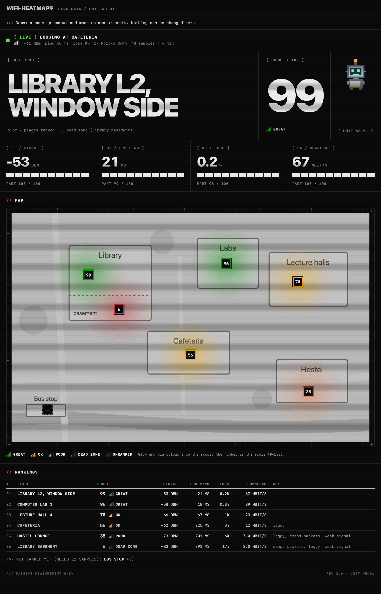
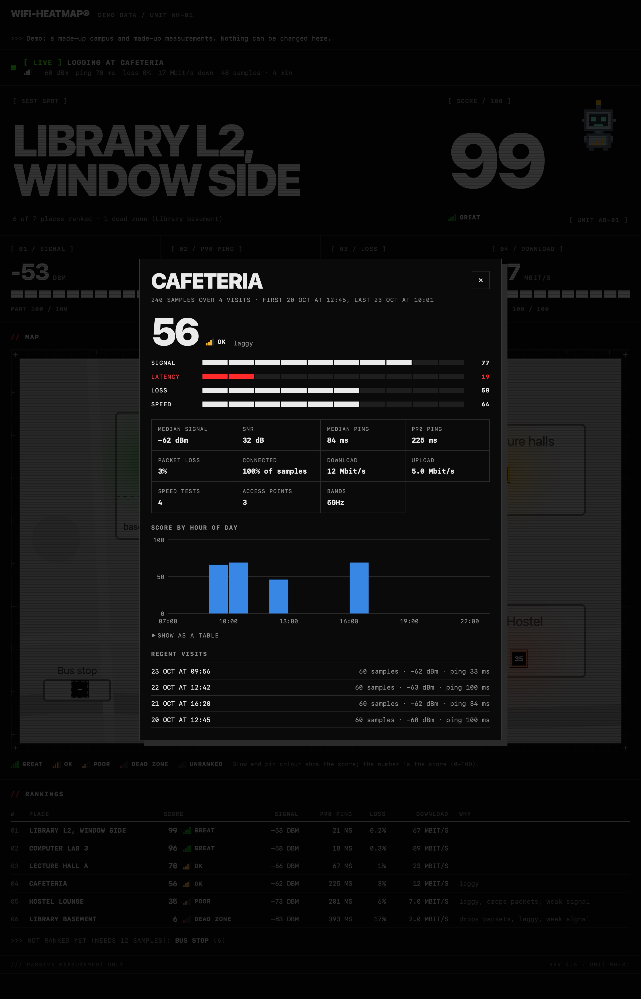
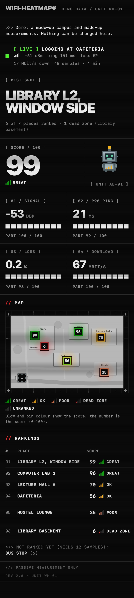

# wifi-heatmap

[](https://github.com/amdpaan/wifi-heatmap/actions/workflows/tests.yml)

A Wi-Fi heatmap for your campus, for macOS. While you move between study spots, wifi-heatmap logs your own
connection's signal strength, latency and speed, then shows which spots are great and which are dead zones,
on a map you provide.

Everything runs locally on your Mac. It only measures your own connection: it reads your Wi-Fi details,
pings a public host and runs an occasional short speed test. It never scans or captures anyone else's
devices or traffic.



<p align="center">
  
  
</p>

<sub>Screenshots come from the built-in demo (`wifi-heatmap serve --demo`): a made-up campus with made-up
measurements and fake access points.</sub>

## Meet the antenna-bot

wifi-heatmap's pixel mascot sits next to the headline. Its chest bars light up with the signal, and its
antenna light takes the colour of the score: it sparks in a great spot, sweats in a poor one and droops in a
dead zone. While you're logging, it follows your live signal and its antenna blinks.

<p align="center"></p>

## Requirements

- macOS 14 or later (tested on macOS 27, Apple Silicon)
- Command Line Tools (`xcode-select --install`), which provide `swiftc` and `python3` (3.9+)

## Install

```sh
git clone https://github.com/amdpaan/wifi-heatmap ~/Projects/wifi-heatmap
cd ~/Projects/wifi-heatmap
./install.sh                  # the `wifi-heatmap` command, the Wi-Fi helper app and Wi-Fi Heatmap.app
./install.sh --agent          # also keeps the dashboard running from login (this Mac only)
./install.sh --agent --lan    # ... and reachable from your phone on the same Wi-Fi, with a private link
```

Then run `wifi-heatmap now` once and allow Location Services when macOS asks (see
[How it works](#how-it-works) for why). Re-run `./install.sh` (with the same options) after `git pull`.
`./uninstall.sh` removes the command, the app and the agent but keeps your data; `./uninstall.sh --purge`
deletes that too.

## Without the terminal

With the agent installed, everything day to day happens in the dashboard:

- **Open it:** **Wi-Fi Heatmap** in Launchpad or `~/Applications` (the antenna-bot icon), the Wi-Fi Heatmap
  card on [claude-widget](https://github.com/amdpaan/claude-widget), or http://127.0.0.1:8766/.
- **Log a place:** **Check in**, type where you are, **Start logging**; **Stop** when you leave.
- **On your phone** (installed with `--lan`): press **Phone** on the dashboard and scan the QR code. Then you
  can check in and stop from your phone while you walk around. The link only shows on the Mac itself.
  Campus Wi-Fi often stops devices from reaching each other; if the page won't load, connect the Mac to your
  phone's hotspot and scan the new code.

## Log a place

```sh
wifi-heatmap log --place "Library L2"     # check in and log every 5 s until Ctrl-C
```

`log` runs one short speed test when you check in (about 10 s and 30 MB; skip it with `--no-speedtest`),
then reads the signal and pings `1.1.1.1` every 5 seconds:

```
Logging at Library L2 every 5 s. Ctrl-C to stop.
Speed: 48.2 Mbit/s down, 21.7 Mbit/s up, RTT 14.0 ms (10.2 s, ~31 MB)
10:02:11  ▂▄▆·  -61 dBm  SNR 33  ch 36 (5GHz)   433 Mbps  ping   18 ms  loss 0%
10:02:16  ▂▄▆·  -63 dBm  SNR 31  ch 36 (5GHz)   390 Mbps  ping   21 ms  loss 0%
^C
Library L2: 2 samples over 0m05s, median signal -62 dBm, median ping 20 ms, 0% loss
```

Once a place has a minute of samples, `wifi-heatmap rank` scores it:

```
    Place                    Score             Signal   p90 ping   Loss     Download
 1. Library L2, window side     99  great      -53 dBm      21 ms     0%     67 Mbit/s
 2. Computer lab 3              96  great      -58 dBm      18 ms     0%     89 Mbit/s
 3. Lecture hall A              70  ok         -66 dBm      66 ms     1%     23 Mbit/s
 4. Cafeteria                   56  ok         -62 dBm     225 ms     3%     12 Mbit/s  (laggy)
 5. Hostel lounge               35  poor       -73 dBm     201 ms     6%      7 Mbit/s  (laggy, drops packets, weak signal)
 6. Library basement             6  dead zone  -83 dBm     393 ms    17%      2 Mbit/s  (drops packets, laggy, weak signal)
Not ranked yet (needs 12 samples): Bus stop (6)

Best study spots: Library L2, window side, Computer lab 3, Lecture hall A
Dead zones: Library basement
```

(That's `wifi-heatmap demo`, the same ranking for the made-up places.)

## Dashboard

```sh
wifi-heatmap serve           # opens http://127.0.0.1:8766/
wifi-heatmap serve --demo    # the same with a made-up campus (changes nothing)
wifi-heatmap serve --lan     # also from your phone on the same Wi-Fi (the Phone button shows the link)
```

- **Map:** upload a campus map or floor plan (PNG, JPEG or WebP; a screenshot of a map app works) and drop a
  pin for each place. Each pin shows the place's score, with a glow in its colour (great, ok, poor, dead zone).
- **Rankings:** every place with its score, signal, p90 ping, loss, download and why it lost points.
- **Place sheet:** click a place for its score parts, all its stats, its score by hour of the day (is the
  cafeteria slow at lunch?) and its recent visits. Rename it or move its pin from there.
- **Check in:** start and stop logging from the dashboard (or your phone, with `--lan`). Logging from the
  terminal shows up live too.

Like net-watch's dashboard, it only answers `127.0.0.1` unless you pass `--lan`; then other devices need the
token in the link (once opened, it's kept in a cookie). Only the Mac itself can see that link, via the Phone
button. The uploaded map stays in your data folder.

## More commands

`now` (one reading, logs nothing), `speedtest [--place NAME]`, `place list`, `place add NAME`,
`place rename OLD NEW` (renaming keeps the history). `wifi-heatmap --help` lists them all.

## How it works

- **Wi-Fi details** come from CoreWLAN, through a small Swift helper (`helper/main.swift`): signal (RSSI),
  noise, channel, band, width, transmit rate and PHY mode. These need no permission.
- **Which access point** (SSID and BSSID) needs Location Services since macOS 14, and macOS only grants that
  to an app, so the helper is built as `WiFi Heatmap Helper.app`. wifi-heatmap never reads your location.
  The app is signed with a local certificate created in your login keychain, so macOS remembers your
  approval across rebuilds.
- **Latency** is a burst of 4 pings; **speed** is macOS's built-in `networkQuality`, capped at 10 seconds.
- **The score** (0–100) blends signal (median RSSI, −85 to −55 dBm), latency (90th-percentile ping, so
  spikes count, 400 to 20 ms), packet loss (8% to 0%) and download speed (1 to 50 Mbit/s), weighted
  35/25/20/20. Without a speed test, the other three are reweighted. See `wifiheatmap/score.py`.
- **Your data** stays in `~/Library/Application Support/wifi-heatmap` (`samples.jsonl`, `places.json`,
  `maps/`), never in the repo.

## Desktop widget

Every check-in, sample and checkout also rewrites `summary.json` in the data folder: the antenna-bot's
mood, what you're logging right now, the best spot and the dead zones (never a network name or access
point). [claude-widget](https://github.com/amdpaan/claude-widget) shows it as a Wi-Fi Heatmap card with
the antenna-bot. `wifi-heatmap summary` rewrites it by hand.

## Development

```sh
/usr/bin/python3 -m unittest discover tests   # tests (a fake Wi-Fi helper; no network needed)
tools/screenshots.sh                          # regenerate docs/screenshots from the demo
```

## License

MIT. The antenna-bot is original pixel art made for this project.
